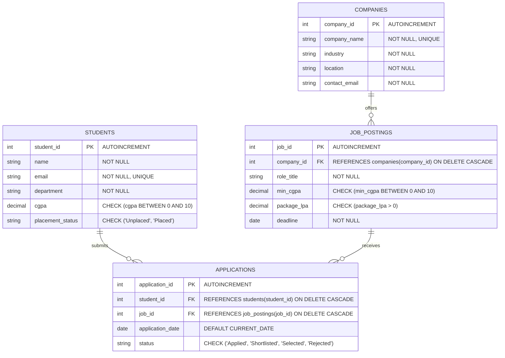

# Smart Campus Placement Management System (RDBMS + Java JDBC)

An academic RDBMS project designed for a university Training & Placement Office (TPO). It implements a normalized relational database schema with real-time business rule enforcement (triggers, constraints, and analytical views) integrated into a lightweight **Java 21 (JDBC)** backend.

---

## 📌 Project Highlights
- **Small & Compact**: Focused on 4 essential tables in **3rd Normal Form (3NF)** without unnecessary bloat.
- **Pure Java 21 + JDBC**: Direct JDBC architecture (`PreparedStatement`, `ResultSet`, Transactions), no bulky Maven or heavyweight frameworks required.
- **Database-Level Business Logic**:
  - **Trigger 1 (`trg_check_cgpa_before_apply`)**: Automatically prevents students with a CGPA lower than the job requirement from applying.
  - **Trigger 2 (`trg_auto_update_placement_status`)**: Automatically updates student placement status to `'Placed'` when an application status changes to `'Selected'`.
  - **View 1 (`v_placement_summary`)**: Real-time department-wise placement statistics, average package, and placement percentage.
  - **View 2 (`v_student_eligible_jobs`)**: Matches students with jobs they qualify for based on CGPA criteria.
- **One-Click Execution**: Comes with `compile.bat` and `run.bat` scripts for Windows.

---

## 🏛️ Entity-Relationship (ER) Diagram



---

## 📐 Relational Schema & Normalization

1. **`students`** (`student_id` (PK), `name`, `email`, `department`, `cgpa`, `placement_status`)
   - *1NF*: All attributes are atomic.
   - *2NF*: All non-key attributes are fully dependent on the primary key `student_id`.
   - *3NF*: No transitive dependencies exist between non-key attributes.
2. **`companies`** (`company_id` (PK), `company_name`, `industry`, `location`, `contact_email`)
3. **`job_postings`** (`job_id` (PK), `company_id` (FK), `role_title`, `min_cgpa`, `package_lpa`, `deadline`)
4. **`applications`** (`application_id` (PK), `student_id` (FK), `job_id` (FK), `application_date`, `status`)
   - `UNIQUE(student_id, job_id)` prevents a student from applying to the same job opening twice.

---

## ⚙️ Project File Structure

```
smart_campus_placement/
│
├── sql/
│   ├── 01_schema.sql             # DDL: Tables, constraints, triggers, and views
│   ├── 02_seed_data.sql          # Realistic test records (10 students, 4 companies, 5 jobs)
│   └── 03_queries.sql            # Evaluation queries (joins, aggregations, subqueries)
│
├── src/
│   └── com/campus/placement/
│       ├── DBConnection.java     # JDBC connection manager & automatic schema loader
│       ├── PlacementApp.java     # Interactive CLI application
│       ├── JavaSystemTest.java   # Automated unit test suite
│       ├── models/               # Java POJO model representations
│       │   ├── Student.java
│       │   ├── Company.java
│       │   ├── JobPosting.java
│       │   └── Application.java
│       └── dao/                  # Data Access Objects (JDBC logic)
│           ├── StudentDAO.java
│           ├── JobDAO.java
│           ├── ApplicationDAO.java
│           └── ReportDAO.java
│
├── lib/                          # JDBC driver & logging libraries
│   ├── sqlite-jdbc.jar
│   ├── slf4j-api.jar
│   └── slf4j-simple.jar
│
├── compile.bat                   # 1-Click compiler for Windows
├── run.bat                       # 1-Click launcher for Windows
└── README.md                     # Project documentation & viva guide
```

---

## 🚀 How to Run the Project

### Prerequisites
- **Java Development Kit (JDK 21 or 17+)** installed and configured in your `PATH`.

### Method 1: Web Browser Frontend (Streamlit Dashboard)
Double-click **`run_frontend.bat`** (or run `streamlit run streamlit_app.py`).
- Opens an interactive web dashboard in your browser.
- Contains tabs for TPO Analytics, Student Application Portal, Company Drives, and Application Management.

### Method 2: Java Backend / Interactive Terminal Interface
1. Double-click **`compile.bat`** to compile the Java classes.
2. Double-click **`run.bat`** to launch the interactive Java CLI application.

### Method 3: Manual Terminal Commands
```powershell
# To run the Web Dashboard:
streamlit run streamlit_app.py

# To run the Java CLI backend:
java -cp "bin;lib/*" com.campus.placement.PlacementApp

# To run the automated Java system verification test:
java -cp "bin;lib/*" com.campus.placement.JavaSystemTest
```

---

## 🧪 Viva Demonstration & Evaluation Guide

When presenting this project to an examiner or instructor, showcase these specific capabilities:

### 1. Demonstrate Trigger 1 (Eligibility Enforcement)
- Choose **Option [4] (Apply for a Job)** in the menu.
- Select Student #9 (**Vikram Nair**, CGPA `6.50`).
- Attempt to apply for Job #1 (**Associate Software Engineer**, Min CGPA `7.50`).
- **Expected Outcome**: The database trigger intercepts the insert and rejects the transaction with:
  `❌ [DATABASE TRIGGER 1 ENFORCED]: Student CGPA is lower than the job requirement. Application rejected!`

### 2. Demonstrate Trigger 2 (Automated Placement Status Synchronization)
- Choose **Option [1]** and verify Student #7 (**Siddharth Rao**) is `'Unplaced'`.
- Choose **Option [4]** to apply Student #7 to Job #5 (Min CGPA `7.00`).
- Choose **Option [5] (Update Application Status)**, select that application, and change the status to `'Selected'`.
- Choose **Option [1]** again: Notice that Student #7's `placement_status` has been automatically updated to `'Placed'` by Trigger 2.

### 3. Demonstrate Analytical Views
- Choose **Option [8] (View Placement Summary)**: Queries view `v_placement_summary` to show department-level placed student counts, placement percentages, and average compensation.
- Choose **Option [9] (Find Eligible Jobs)**: Queries view `v_student_eligible_jobs` for any student ID.

### 4. Demonstrate Advanced SQL Queries
- Choose **Option [10]** to run complex multi-table joins, subqueries using `MAX()`, and `HAVING` aggregations.
